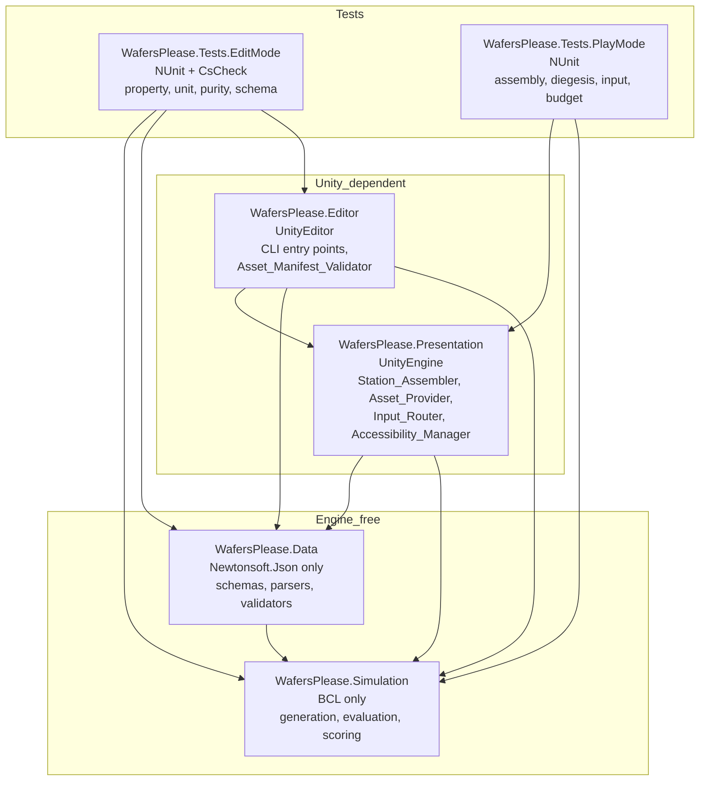
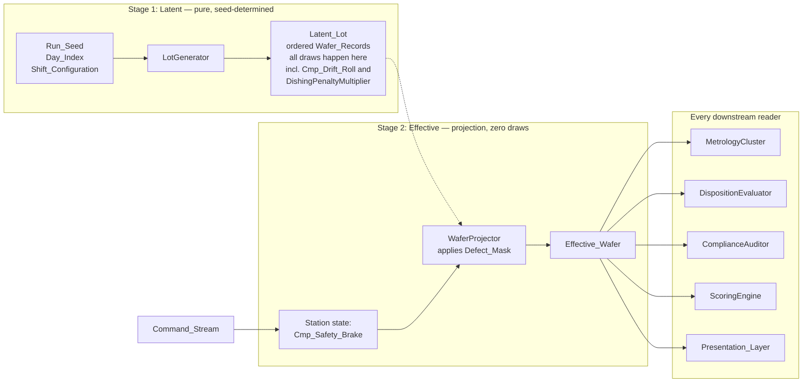
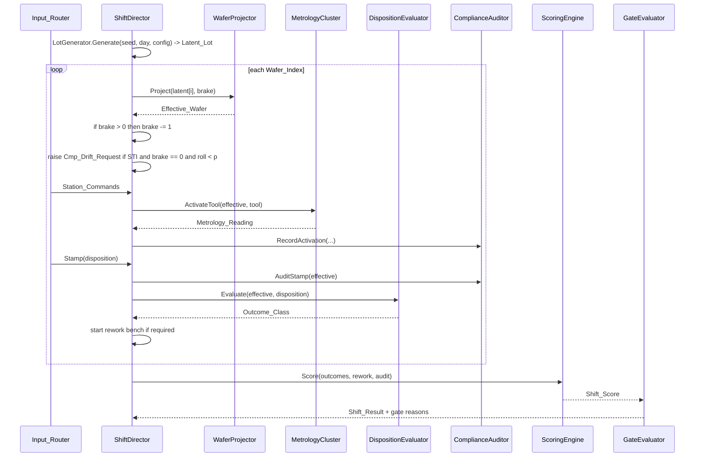
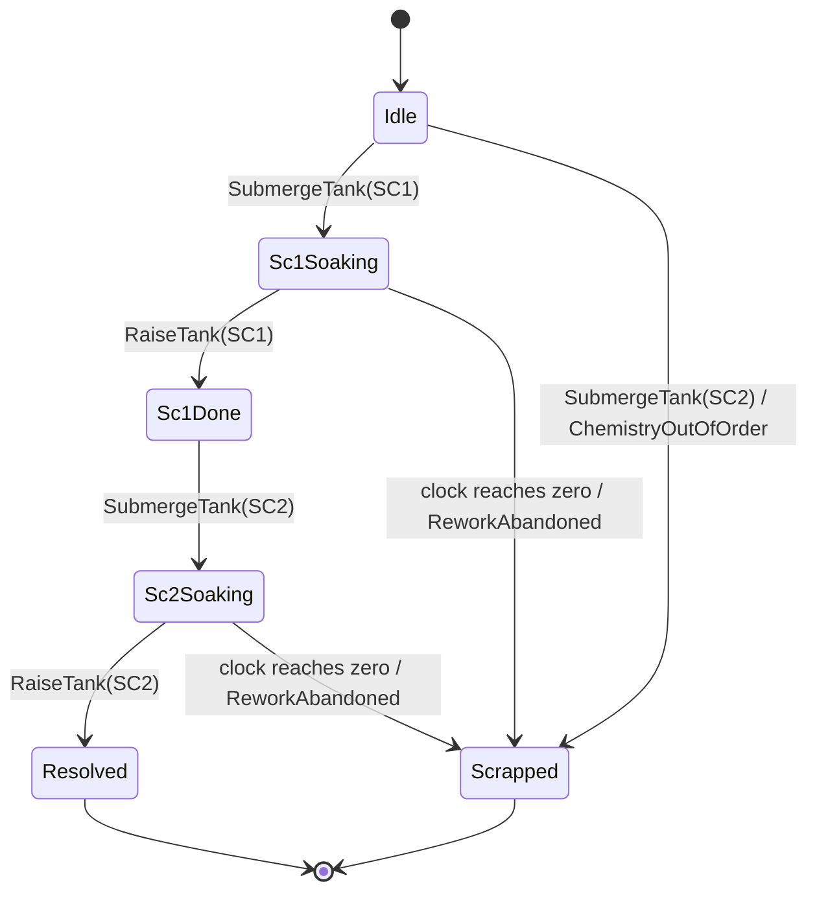

# Design Document

## Overview

Wafers Please MVP is a Unity 6 desktop-first training game whose entire assessment surface — lot generation, metrology, disposition evaluation, rework mini-games, scoring, and gating — lives in a plain-C# assembly with no dependency on the Unity engine. That single constraint drives most of this design. If the assessment logic cannot reference `UnityEngine`, then it can be exercised from a headless batch-mode test run, its determinism can be proven by differential replay, and its correctness properties can be checked by a property-based testing library across hundreds of generated cases. The Unity layers above it become a thin, replaceable presentation shell.

The design resolves three structural tensions that Requirements 2, 8, 12, and 14 make explicit.

**Determinism versus player-driven station state.** Requirement 2 demands that `(Run_Seed, Day_Index, Shift_Configuration)` fully determine the lot, while Requirement 8 makes the CMP safety brake — a consequence of player action — suppress STI void seams. The design splits generation into two stages. The `LotGenerator` produces a **Latent_Lot**, a pure function of the seed triple, in which every random draw occurs, including a per-wafer `Cmp_Drift_Roll` drawn unconditionally and the `DishingPenaltyMultiplier` weight adjustment folded into the latent draw. A separate `WaferProjector` produces an **Effective_Wafer** per presentation by applying the `Defect_Mask` to a latent entry. The projector executes zero draws. Determinism and reactive station state coexist because they operate on different objects.

**Pedagogy versus visual affordance.** Requirement 12 permits an unaided-visual detection path, which would let a player bypass tool selection by tilting the wafer. The design carries `Visually_Detectable` as an authored `Defect_Profile` field and gates the unaided path on it, so the three subsurface classes — `StiVoidSeam`, `InterfaceTrapsRoughness`, `TungstenPlugVoid` — render nothing until a revealing `Tool_Activation` completes. The overlay decision is a single pure predicate in `Simulation_Core`, not a shader-side heuristic, which makes it directly testable.

**Bit-exact reproducibility versus floating-point reality.** Requirement 2.5 forbids floating-point platform intrinsics. The design uses a counter-based integer RNG, restricts `Simulation_Core` floating-point arithmetic to the exactly-rounded IEEE-754 operation set, bans transcendental functions outright, and enforces the ban with an IL-scanning purity test rather than a code-review convention. The CMP reflectance curve is therefore specified as a polynomial envelope over an authored ripple table rather than as a sine wave.

### Verification posture in this environment

The target editor is `6000.5.0f1` at `~/Unity/Hub/Editor/6000.5.0f1/Editor/Unity`, revision `88b47c5e7076` — the same version `git HEAD` already declares in `ProjectSettings/ProjectVersion.txt`. Its `Editor/Data/PlaybackEngines` directory contains `AndroidPlayer`, `LinuxStandaloneSupport`, and `WindowsStandaloneSupport`, and nothing else. `modules.json` records module id `webgl` ("Web Build Support") as `selected: false`, while `linux-il2cpp` is `selected: true`.

The locally installed `6000.4.5f1` was evaluated as an alternative and rejected. It carries an identical playback-engine set and the identical `webgl` status, so the WebGL gap is a property of this machine rather than of either editor version, and no version choice available here closes it.

The consequence for this design is concrete: **Linux standalone is the verifiable build target and EditMode is the verifiable test surface.** WebGL settings are authored and committed per Requirement 1.9, but no WebGL build can be produced or validated here until the module is installed. Requirement 22.6 and 22.7 already mark the 90 FPS WebXR frame-time target as manually verified for the same reason. The design keeps every gameplay-correctness claim on the headless path so that the absence of the WebGL module blocks shipping, not development.

### Design decisions and rationale

| Decision | Rationale |
| :---- | :---- |
| `Simulation_Core` is plain C# with zero Unity references | Makes Requirements 2 through 11 and 14 through 16 verifiable in EditMode with no scene, no play loop, and no graphics device (Requirement 1.4, 23.4). |
| Two-stage `Latent_Lot` → `Effective_Wafer` generation | The only structure that satisfies Requirement 2.2 and Requirement 8.12 simultaneously. |
| Counter-based RNG addressed by `Stream_Key`, no sequential state | Gives O(1) random access per `(Wafer_Index, Channel_Id)`, so a draw-count change on one wafer cannot perturb another (Requirement 2.3, 2.6). |
| Integer ladder for weighted draws | Bucket and routing selection decide the defect. Removing floating-point comparison from that decision removes the highest-consequence source of platform drift. |
| Banned-API purity enforced by IL scan, not convention | A convention is not a test. Mono.Cecil ships with the editor, so the ban is checkable in CI. |
| `WafersPlease.Data` parses strings and is also Unity-free | Lets EditMode tests round-trip every schema without `Resources`, `TextAsset`, or a scene, satisfying Requirement 21.11 headlessly, while keeping the assembly count at the four Requirement 1.3 mandates. |
| Station built at runtime by `Station_Assembler`, not authored as a scene | Keeps `Bootstrap.unity` to three GameObjects, so scene YAML stays diff-reviewable and the diegetic constraint of Requirement 17 is enforced in code rather than in a hierarchy nobody can audit. |
| Editor `6000.5.0f1` rather than `6000.4.5f1` | It matches `git HEAD`'s declared `ProjectVersion.txt` and HEAD's pinned URP `17.5.0` exactly, so `ProjectSettings/` is recovered without an unsupported downgrade; it does not change WebGL availability, which is absent from both. |
| CsCheck 2.14.1 as the property-based testing library | Last release targeting `netstandard2.0`, zero package dependencies. CsCheck 3.x moved to `net6.0` and 4.x to `net8.0`, neither of which loads under Unity's .NET Standard profile. `6000.5.0f1` ships `Editor/Data/NetStandard/ref/2.1.0`, the same reference profile as `6000.4.5f1`, so the retarget does not disturb this choice. |
| `Asset_Provider` indirection for every art and audio request | Requirement 19 requires drop-in asset replacement without gameplay code edits; a key registry plus procedural fallback is the smallest structure that delivers it. |

## Architecture

### Assembly layout



| Assembly | Path | References | Hard constraint |
| :---- | :---- | :---- | :---- |
| `WafersPlease.Simulation` | `Assets/Scripts/Simulation/WafersPlease.Simulation.asmdef` | none | Zero `UnityEngine`, zero `UnityEditor`, zero `Newtonsoft.Json` (Requirement 1.4) |
| `WafersPlease.Data` | `Assets/Scripts/Data/WafersPlease.Data.asmdef` | `WafersPlease.Simulation`, `Newtonsoft.Json` | Zero `UnityEngine`; parses `string`, performs no file IO |
| `WafersPlease.Presentation` | `Assets/Scripts/Presentation/WafersPlease.Presentation.asmdef` | `WafersPlease.Simulation`, `WafersPlease.Data`, `Unity.InputSystem`, `Unity.RenderPipelines.Universal.Runtime` | Owns all file and `Resources` access; zero asset path literals (Requirement 19.6) |
| `WafersPlease.Editor` | `Assets/Scripts/Editor/WafersPlease.Editor.asmdef` | all three above, `Mono.Cecil` | `includePlatforms: [Editor]` |
| `WafersPlease.Tests.EditMode` | `Assets/Tests/EditMode/WafersPlease.Tests.EditMode.asmdef` | all four above, `UnityEngine.TestRunner`, `UnityEditor.TestRunner`, `CsCheck` | `includePlatforms: [Editor]` |
| `WafersPlease.Tests.PlayMode` | `Assets/Tests/PlayMode/WafersPlease.Tests.PlayMode.asmdef` | `Simulation`, `Data`, `Presentation`, `UnityEngine.TestRunner` | Runtime-capable |

`WafersPlease.Data` references `Newtonsoft.Json` through `precompiledReferences` with `overrideReferences: true`, which is what allows a Unity-free assembly definition to link the package DLL. `CsCheck.dll` is vendored at `Assets/Plugins/CsCheck/CsCheck.dll` with a `.meta` restricting it to the Editor platform. The committed `.gitattributes` already routes `*.dll` through Git LFS, so vendoring the DLL requires LFS to be initialized in the clone; the design records this as a checkout prerequisite rather than adding a `.gitattributes` exception, because the existing template is upstream-maintained.

### The two-stage generation pipeline

This is the architectural expression of Correction 1. The dashed boundary is the determinism boundary: nothing to its right can influence anything to its left.



Three invariants make the split sound, and each maps to a correctness property below.

1. **Draw-count invariance.** `LotGenerator` performs the same number of draws on the same `Channel_Id` set for the same `Wafer_Index` regardless of anything the player does. The `Cmp_Drift_Roll` is drawn on channel `CmpDriftRoll` for every wafer, not only for `ShallowTrenchIsolation` wafers, and not only when the brake is down. The `DishingPenaltyMultiplier` is applied by scaling the `StiVoidSeam` entry of the integer weight ladder before the single bucket draw, so the multiplier changes the ladder, never the draw count.
2. **Masking is a projection, not a regeneration.** `WaferProjector` reads a latent entry and the brake counter and returns a new record. It holds no `RngStream`, and its signature makes that structural: it receives no `Run_Seed`.
3. **Field provenance is explicit.** `Effective_Wafer` copies `Wafer_Index`, `Routing_Step`, `Signal_Magnitude`, `Phase_State`, `Organic_Load`, `Metallic_Load`, and `Required_Metrology_Set` verbatim. Only `Defect_Class` and `Defect_Severity` can differ. The `Required_Metrology_Set` therefore survives masking untouched: Requirement 5.2 derives it from `Routing_Step` alone, and masking changes no `Routing_Step`. A masked STI wafer still lists `SpectroscopicEllipsometry` as mandatory, so skipping the tool still incurs an `Out_Of_Sequence` violation. That is the correct pedagogy — the traveler does not know the polisher was just recalibrated.

### Shift execution flow



The brake decrement in Requirement 8.11 fires on every presentation, and the projection reads the brake **before** the decrement for that same wafer. The design fixes the order explicitly — project, then decrement — so that a brake value of 1 protects exactly the next wafer presented and no more. Golden scenarios pin this ordering, because an off-by-one here silently changes five wafers per successful calibration.

### Determinism substrate

**Rng_Stream.** A stateless counter-based generator. Every value is a function of `(Stream_Key, draw_index)` with no mutable state, so any draw is addressable in constant time and no draw can depend on the order in which streams are consumed.

All arithmetic below is unsigned 64-bit with wrapping overflow. `>>>` is a logical right shift. `GOLDEN = 0x9E3779B97F4A7C15`.

```
mix64(x):
    x = x XOR (x >>> 30)
    x = x * 0xBF58476D1CE4E5B9
    x = x XOR (x >>> 27)
    x = x * 0x94D049BB133111EB
    x = x XOR (x >>> 31)
    return x

stream_seed(run_seed, day_index, wafer_index, channel_id):
    h = mix64(run_seed          XOR (GOLDEN * 1))
    h = mix64(h + day_index     +   (GOLDEN * 2))
    h = mix64(h + wafer_index   +   (GOLDEN * 3))
    h = mix64(h + channel_id    +   (GOLDEN * 4))
    return h

next_u64(stream_seed, draw_index):
    return mix64(stream_seed + GOLDEN * (draw_index + 1))
```

This is the SplitMix64 mixing function used as a counter-based hash: `stream_seed` selects the sequence and `draw_index` indexes into it directly. The construction uses only XOR, wrapping multiply, wrapping add, and logical shift, all of which are exactly defined by the C# language specification on every platform. No table, no floating point, no platform intrinsic.

Derived draws, in order of preference:

- **Unit double**, `[0, 1)`: `(next_u64() >>> 53_shift) * 2^-53` where the shift keeps the top 53 bits. The numerator is an integer below 2^53 and therefore exact as a `double`; scaling by a power of two is exact; the result is bit-identical on every IEEE-754 platform.
- **Bounded integer**, `[0, bound)`: rejection sampling. `limit = UInt64.MaxValue - (UInt64.MaxValue mod bound)`; draw until `raw < limit`; return `raw mod bound`. Unbiased, integer-only, and no 128-bit multiply. Rejection consumes extra draws, but rejection depends only on the seed, so draw-count invariance across `Command_Streams` still holds.
- **Weighted selection** over N weights: the weights are converted once, at config load, into a cumulative **integer ladder** scaled to 2^32 with a documented largest-remainder rounding rule, and selection compares `next_u64() >>> 32` against the ladder. Routing-step selection, defect-bucket selection, and defect-class-within-bucket selection all use the ladder. This removes floating-point comparison from every decision that determines what defect a wafer carries.
- **Range double**, `[lo, hi]`: `lo + (hi - lo) * unit_double()`. Three exactly-rounded operations. Used only for continuous cosmetic and tolerance values such as `Signal_Magnitude`, `Organic_Load`, `Metallic_Load`, and the C49 window bounds.

**Channel_Id registry.** `Channel_Id` values are append-only and never reordered or reused; changing one invalidates every committed golden scenario. Per-shift channels use the sentinel `Wafer_Index = 0xFFFFFFFF`.

| Id | Channel | Draws per wafer |
| :---- | :---- | :---- |
| 0 | `RoutingStep` | 1 |
| 1 | `DefectBucket` | 1 |
| 2 | `DefectClassWithinBucket` | 1 |
| 3 | `SignalMagnitude` | 1 |
| 4 | `PhaseState` | 1 |
| 5 | `OrganicLoad` | 1 |
| 6 | `MetallicLoad` | 1 |
| 7 | `CmpDriftRoll` | 1, unconditional |
| 8 | `CmpTargetGain` | 1 |
| 9 | `CmpTargetPhase` | 1 |
| 10 | `C49WindowOpen` | 1 |
| 11 | `C49WindowClose` | 1 |
| 12 | `DefectRegionLayout` | 1 |
| 13 | `QuizSelection` | per shift, sentinel index |

Every channel draws exactly once per wafer, unconditionally, including channels whose value the wafer will not use. A `SubstratePreparation` wafer still draws `PhaseState` and `C49WindowOpen`; the values are simply ignored. Drawing unconditionally is what makes draw-count invariance a structural property rather than a discipline, and it satisfies Requirement 14.5 and Requirement 2.3 by construction. The cost is thirteen wasted draws per wafer, which is negligible against Requirement 22.5's 250 ms budget for a 20-wafer shift.

**Numeric purity rules for `WafersPlease.Simulation`.**

| Allowed | Forbidden |
| :---- | :---- |
| `double` with `+ - * /`, comparison | `float` / `System.Single` in any signature or field |
| `Math.Sqrt`, `Abs`, `Min`, `Max`, `Floor`, `Ceiling`, `Truncate` | `Sin`, `Cos`, `Tan`, `Asin`, `Acos`, `Atan`, `Atan2`, `Exp`, `Log`, `Log10`, `Log2`, `Pow`, `Cbrt`, and all `MathF.*` |
| `SortedDictionary`, `SortedSet`, arrays, `List<T>` | Iteration order of `Dictionary<K,V>` or `HashSet<T>` in any output path |
| `CultureInfo.InvariantCulture` formatting | `DateTime`, `Stopwatch`, `Environment.TickCount`, `Guid.NewGuid`, `System.Random` |

Each allowed floating-point operation is exactly rounded by IEEE-754, so results are bit-identical across Mono, IL2CPP, and WebAssembly. The forbidden transcendentals are the ones IEEE-754 leaves implementation-defined. This is why the CMP reflectance curve is not a sine wave: see `Cmp_Calibration_Console` below.

## Components and Interfaces

Signatures are shown to fix contracts and visibility; method bodies are out of scope for this document.

### Simulation_Core

```csharp
// Deterministic substrate
public readonly struct StreamKey {
    public readonly ulong RunSeed; public readonly uint DayIndex;
    public readonly uint WaferIndex; public readonly uint ChannelId;
}
public readonly struct RngStream {
    public static RngStream Open(StreamKey key);
    public ulong NextU64(uint drawIndex);
    public double NextUnitDouble(uint drawIndex);
    public ulong NextBelow(ulong bound, ref uint drawIndex);
    public int SelectFromLadder(IntegerWeightLadder ladder, uint drawIndex);
}
public readonly struct IntegerWeightLadder {
    public static IntegerWeightLadder FromWeights(ReadOnlySpan<double> weights); // largest-remainder to 2^32
    public IntegerWeightLadder WithScaledEntry(int index, double multiplier);
}

// Stage 1 — latent
public sealed class LotGenerator {
    public LatentLot Generate(ulong runSeed, uint dayIndex, ShiftConfiguration config,
                              IAnalyticsSink analytics);
}
public sealed class LatentLot {
    public int Count { get; }
    public WaferRecord this[int waferIndex] { get; }
}

// Stage 2 — projection. No RngStream, no Run_Seed: masking cannot draw.
public sealed class WaferProjector {
    public EffectiveWafer Project(in WaferRecord latent, int cmpSafetyBrake);
    public static bool IsMasked(in WaferRecord latent, int cmpSafetyBrake);
}

// Evaluation, all reading EffectiveWafer
public sealed class MetrologyCluster {
    public void MountFromDayConfig(DayConfig day);
    public MetrologyReading Activate(in EffectiveWafer wafer, MetrologyTool tool);
    public bool TrySelectSlot(int slot);                 // false when the slot is empty
    public bool IsBusy { get; }
}
public static class DispositionEvaluator {
    public static Disposition CorrectDispositionFor(in EffectiveWafer wafer);
    public static OutcomeClass Evaluate(in EffectiveWafer wafer, Disposition stamped);
}
public sealed class ComplianceAuditor {
    public void RecordActivation(in EffectiveWafer wafer, MetrologyTool tool, ReadingStatus status);
    public int AuditStamp(in EffectiveWafer wafer);      // returns Out_Of_Sequence count
    public double MetrologyOptimizationRate { get; }
    public double ProcessCompliance { get; }
}
public static class OverlayPolicy {
    // Requirement 12.6 and 12.7 as one pure predicate
    public static bool PermitsOverlay(in EffectiveWafer wafer, DefectProfile profile,
                                      bool revealedByTool, double visualDetectionThreshold);
}

// Rework benches — each an explicit state machine
public sealed class RcaCleanBench   { public RcaState State { get; }
                                      public void Apply(StationCommand c, double shiftSeconds);
                                      public ReworkOutcome? Outcome { get; } }
public sealed class SilicideEtchBench { public EtchState State { get; }
                                        public void Apply(StationCommand c, double shiftSeconds);
                                        public ReworkOutcome? Outcome { get; } }
public sealed class CmpCalibrationConsole { public CmpState State { get; }
                                            public void Apply(StationCommand c);
                                            public double CalibrationError { get; }
                                            public ReworkOutcome? Outcome { get; }
                                            public int BrakeArmCount { get; } }

// Orchestration and assessment
public sealed class ShiftDirector {
    public ShiftDirector(LatentLot lot, ShiftConfiguration config, IAnalyticsSink analytics);
    public EffectiveWafer? Presented { get; }
    public double ShiftClockSeconds { get; }
    public int CmpSafetyBrake { get; }
    public void Consume(StationCommand command);
    public void Advance(double deltaSeconds);
    public bool Ended { get; }
}
public static class ScoringEngine { public static ShiftScore Score(ShiftLedger ledger, ScoringTable table); }
public static class GateEvaluator { public static ShiftResultRecord Evaluate(ShiftScore s, DayConfig d, int repeatCount); }
public sealed class AnalyticsRecorder : IAnalyticsSink {
    public void Append(AnalyticsEvent e);                 // nondecreasing timestamp enforced
    public DebriefReport Aggregate(ShiftScore s, ShiftResultRecord r);
}
public static class DeterministicText {
    public static string Serialize(in ShiftScore score);   // fixed field order, G9 invariant
    public static string Serialize(in DebriefReport report);
}
```

**`Cmp_Calibration_Console` reflectance curve.** Requirement 8.7 needs a root-mean-square error between a player curve and a reference curve at 64 sample points, and the physical referent is a damped oscillating endpoint trace. A sine would import a transcendental. The design instead defines reflectance at normalized position `t` in `[0, 1]` as

```
R(t; gain, phase) = envelope(t) * ripple(t, phase) * gain_scale(gain)
  envelope(t)     = (1 - t) * (1 - t) * (3 - 2 * (1 - t))       // cubic decay, exact
  ripple(t,phase) = piecewise-linear interpolation over 16 authored control points,
                    sampled at fractional index frac(t * 16 + phase * 16)
  gain_scale(g)   = 0.5 + g                                     // linear
```

The 16 ripple control points are authored in `Balancing_Config`, which keeps the curve's feel tunable without code changes and keeps every operation inside the allowed set. RMS then needs one `Math.Sqrt`, which is exactly rounded.

**Rework bench state machines.** Each bench is modelled as an explicit finite state machine rather than a coroutine, because Requirement 6.15, 7.9, and 11.13 all require that clock exhaustion resolve mid-procedure, and a state machine makes clock exhaustion just another transition. Each bench exposes `Outcome` as nullable and non-null exactly once, which is the invariant the property tests target.



### Data layer

```csharp
public static class ConfigParser {
    public static ParseResult<DefectProfileSet>   ParseDefectProfiles(string json, string sourcePath);
    public static ParseResult<DayConfig>          ParseDayConfig(string json, string sourcePath);
    public static ParseResult<BalancingConfig>    ParseBalancingConfig(string json, string sourcePath);
    public static ParseResult<ScoringTable>       ParseScoringTable(string json, string sourcePath);
    public static ParseResult<GlossaryEntrySet>   ParseGlossary(string json, string sourcePath);
    public static ParseResult<BulletinPageSet>    ParseBulletins(string json, string sourcePath);
    public static ParseResult<QuizQuestionSet>    ParseQuizQuestions(string json, string sourcePath);
    public static ParseResult<LocalizationTable>   ParseLocalization(string json, string sourcePath);
    public static ParseResult<AccessibilityProfile> ParseAccessibility(string json, string sourcePath);
    // Round-trip half of Requirement 21.11
    public static string Serialize<T>(T config);
}
public readonly struct ParseResult<T> {
    public bool Ok { get; } public T Value { get; }
    public IReadOnlyList<ValidationError> Errors { get; }
}
public readonly struct ValidationError {
    public string SourcePath { get; } public string FieldPath { get; }
    public string ViolatedConstraint { get; }             // Requirement 21.10
}
```

Serialization is Newtonsoft with `Formatting.Indented`, `FloatParseHandling.Double`, `CultureInfo.InvariantCulture`, and explicit `[JsonProperty(Order = n)]` on every member, which is what makes the round-trip of Requirement 21.11 an equality rather than an approximation. The parser is total: it returns `ParseResult` and throws no exception on malformed input, so a bad config file is a reported validation error rather than a crash.

### Presentation layer

```csharp
public interface IAssetProvider {
    Mesh        Mesh(AssetKey key);
    Texture2D   Texture(AssetKey key);
    Material    Material(AssetKey key);
    AudioClip   Audio(AssetKey key);
    string      Text(AssetKey key);
}
public sealed class AssetProvider : IAssetProvider { /* authored lookup, then procedural fallback */ }
public static class AssetKeyRegistry {
    public const string WaferBaseMesh = "mesh.wafer.base";
    // ... every key, as compile-time constants in this one place (Requirement 19.1)
    public static IReadOnlyList<string> All { get; }
}
public sealed class StationAssembler : MonoBehaviour {
    public StationHandles Assemble(ShiftConfiguration config, IAssetProvider assets);
}
public sealed class InputRouter : MonoBehaviour {
    public void RegisterBackend(IInputBackend backend);
    public IReadOnlyList<StationCommand> DrainCommands();
}
public interface IInputBackend { void Poll(ICommandSink sink); }
public sealed class DesktopInputBackend : IInputBackend { }
#if WAFERS_XR
public sealed class XrInputBackend : IInputBackend { }
#endif
public sealed class AccessibilityManager : MonoBehaviour { public void Apply(AccessibilityProfile p); }
public sealed class ScaffoldingPresenter : MonoBehaviour { }
public sealed class IncidentPrinter : MonoBehaviour { public void Print(DebriefReport r); }
```

**`Asset_Provider` and the `ASSETS.md` contract.** `Asset_Key_Registry` is the single compile-time source of truth. `Asset_Provider` resolves a key in three steps: authored asset at the mapped path, else procedural placeholder with an `PlaceholderUsed` analytics event, else — for a key the registry does not declare — a magenta error material with an `UnknownAssetKey` event. Procedural generation is deliberately crude: primitives for meshes, `Texture2D` writes for textures, URP `Lit`/`Unlit` presets for materials, and synthesized clips for audio. The contract with `ASSETS.md` is bidirectional and enforced by `Asset_Manifest_Validator` as an EditMode test: the key set parsed from the `ASSETS.md` table must equal `AssetKeyRegistry.All` exactly, with both directions of the difference reported by name. A designer adding a row without a constant, or a programmer adding a constant without a row, fails the build. `ASSETS.md` covers every entry of the game design document inventory sections A through H, one row per key, carrying key string, current placeholder, `P0`/`P1`/`P2` priority, expected format, dimension or triangle budget, and drop-in repository path.

**`Input_Router` and the parity guarantee.** Backends produce `Station_Commands` and nothing else. `Simulation_Core` names no device type, so the desktop and XR paths converge on the same `Command_Stream` type and Requirement 18.9's parity claim reduces to a replay equality that EditMode can check without any input hardware.

### Editor layer

```csharp
public static class Cli {
    public static void CompileOnly();       // exit 0, or 1 with the error list on stderr
    public static void BuildLinux64();      // the verifiable build path
    public static void BuildWebGl();        // fails fast with the module-install command
    public static void ValidateAssetManifest();
    public static void ResolvePackagesOrFail();   // Requirement 1.7
}
public static class PurityScanner {
    // Mono.Cecil IL walk over WafersPlease.Simulation.dll
    public static IReadOnlyList<PurityViolation> Scan(string assemblyPath);
}
```

`PurityScanner` walks every method body in the compiled `Simulation` assembly and flags any `call`/`callvirt` to a member on the forbidden list, any `float32` in a signature or field, and any assembly reference outside the BCL allowlist. It runs as an EditMode test, so the purity rules of Requirement 2.5 are enforced mechanically. This is the piece that keeps the determinism guarantee from decaying: a well-meaning `Math.Sin` added in month three fails a test instead of silently breaking WebGL reproducibility.

### Scene strategy

`Assets/Scenes/Bootstrap.unity` is the only hand-authored scene, and it is deliberately trivial. It contains the four scene singletons Unity always writes (`OcclusionCullingSettings`, `RenderSettings`, `LightmapSettings`, `NavMeshSettings`) plus exactly three GameObjects:

| GameObject | Components |
| :---- | :---- |
| `Main Camera` | `Transform`, `Camera` |
| `Directional Light` | `Transform`, `Light` |
| `Bootstrap` | `Transform`, `StationBootstrap` (MonoBehaviour) |

`StationBootstrap` loads configuration, constructs `AssetProvider`, and invokes `Station_Assembler`. Everything visible — bay, workbench, cassettes, tool rack, four metrology screens, traveler clipboard, three stamps, glossary tablet, overhead shift board, incident printer, rework console, and every overlay — is created at runtime.

Four rules keep the YAML small and mechanical, and an EditMode guard test enforces the first three:

1. At most three `--- !u!1 &` GameObject documents, and zero `--- !u!1001 &` PrefabInstance documents. No prefab in the scene means no prefab-override YAML, which is the usual source of unreviewable scene diffs.
2. A byte ceiling on the file. The scene is expected around 300 lines; the test asserts a generous ceiling so that an accidental drag-and-drop of a prop into the scene fails visibly.
3. Zero baked lighting. `m_GIWorkflowMode` is set to on-demand and lighting is never baked, so no `LightingData.asset`, no lightmap references, and no per-object lighting payload enter the file.
4. Committed `.gitattributes` already marks `*.unity` as `unity-yaml` with `merge=unityyamlmerge` and `eol=lf`, so line endings stay stable across machines.

The payoff is that a scene diff is always reviewable by a human, and that the station composition lives in C# and configuration where it can be unit-tested, which is what makes Requirement 17's diegetic constraint checkable: `Station_Assembler` is asserted to create zero screen-space canvases for gameplay information and at most one tagged `SystemOverlay`.

### Project bootstrap

The working tree currently has no Unity project; `git HEAD` holds a complete Unity 6000.5.0f1 XR-template project of 1233 files, all deleted in the working tree. The design recovers the parts worth keeping rather than authoring them fresh, and discards the XR sample content.

**Recovery procedure.**

1. `git checkout HEAD -- ProjectSettings/` to restore all 31 settings assets. Authoring `ProjectSettings.asset` from scratch is error-prone; adapting a known-good one is not. This restores `ProjectVersion.txt` already declaring `6000.5.0f1 (88b47c5e7076)`, so no version edit is required and no unsupported downgrade occurs. Targeting `6000.5.0f1` is what makes this step a plain checkout.
2. Delete `Packages/packages-lock.json` so the resolver rebuilds it from the manifest below, and ensure no `Library/` exists before first open.
3. Author `Packages/manifest.json` as the adapted manifest below.
4. Leave `Assets/` deleted. The XR Hands, XR Interaction Toolkit, VR template, and TextMesh Pro sample content at HEAD is not MVP surface and would inflate the asset budget of Requirement 22.3.
5. Set `webGLCompressionFormat: 0` (Brotli; HEAD has `1`, Gzip) and the WebGL `managedStrippingLevel` to `Low`, per Requirement 1.9.
6. Strip XR loaders from `ProjectSettings/XRSettings.asset` while `Xr_Feature_Flag` is off, so the desktop build stays playable per Requirement 18.7.

**Manifest adaptation.** Every version below was read from the editor's own package database at `~/Unity/Hub/Editor/6000.5.0f1/Editor/Data/Resources/PackageManager/Editor/manifest.json` rather than guessed. URP resolves to **17.5.0**, matching both HEAD's pin and the built-in package at `.../BuiltInPackages/com.unity.render-pipelines.universal`, whose own `package.json` declares `"version": "17.5.0"` and `"unity": "6000.5"`. Because it is built in, it needs no registry fetch, and because it agrees with HEAD, the render-pipeline pin is no longer an adaptation at all.

Retargeting from `6000.4.5f1` to `6000.5.0f1` retired most of the version adaptations that the earlier draft carried. The `6000.4` package database capped `com.unity.learn.iet-framework` at 5.0.3, the Linux SDK and toolchain at 1.0.1, and the whole XR set below HEAD. The `6000.5.0f1` database was re-read package by package, and every one of those ceilings is gone: `iet-framework` is 5.0.4, both Linux packages are 1.1.0, and all seven XR packages sit at exactly their HEAD versions. The removals below therefore rest on MVP scope alone, which is a more durable justification than a version ceiling.

One genuine version correction appears in the other direction. `com.unity.test-framework` has a `minimumVersion` of **1.7.0** on `6000.5.0f1` against 1.6.0 on `6000.4.5f1`, so the pin must move up; 1.6.0 would sit below the editor's floor. Similarly, `com.unity.ide.rider` bundles **3.0.38** here while HEAD pins 3.0.39, so the manifest follows the bundled version to keep resolution local.

```json
{
  "dependencies": {
    "com.unity.feature.development": "1.0.2",
    "com.unity.ide.rider": "3.0.38",
    "com.unity.inputsystem": "1.19.0",
    "com.unity.nuget.newtonsoft-json": "3.2.2",
    "com.unity.render-pipelines.universal": "17.5.0",
    "com.unity.test-framework": "1.7.0",
    "com.unity.modules.accessibility": "1.0.0",
    "com.unity.modules.animation": "1.0.0",
    "com.unity.modules.audio": "1.0.0",
    "com.unity.modules.imageconversion": "1.0.0",
    "com.unity.modules.imgui": "1.0.0",
    "com.unity.modules.jsonserialize": "1.0.0",
    "com.unity.modules.physics": "1.0.0",
    "com.unity.modules.ui": "1.0.0",
    "com.unity.modules.uielements": "1.0.0",
    "com.unity.modules.unitywebrequest": "1.0.0"
  }
}
```

In the table below, "6000.5.0f1 DB" is the version recorded in that editor's own package database, and a bolded MVP version marks a deliberate divergence from HEAD.

| Package at HEAD | HEAD version | 6000.5.0f1 DB | MVP version | Reason |
| :---- | :---- | :---- | :---- | :---- |
| `com.unity.render-pipelines.universal` | 17.5.0 | 17.5.0 | 17.5.0 | Built-in package on this editor; agrees with HEAD, so no adaptation and no registry fetch |
| `com.unity.feature.development` | 1.0.2 | 1.0.2 | 1.0.2 | Unchanged |
| `com.unity.inputsystem` | 1.19.0 | 1.19.0 | 1.19.0 | Unchanged; Requirement 18 depends on it |
| `com.unity.ide.rider` | 3.0.39 | 3.0.38 | **3.0.38** | Follow the bundled version so resolution stays local; HEAD's 3.0.39 is above the floor but requires a registry fetch |
| `com.unity.test-framework` | implicit | 1.7.0 | **1.7.0** pinned | Requirement 1.2 names it explicitly; do not rely on `feature.development` transitivity. 1.7.0 is this editor's `minimumVersion`, so the 6000.4-era 1.6.0 pin would sit below the floor |
| `com.unity.nuget.newtonsoft-json` | implicit | 3.2.2 | **3.2.2** pinned | `WafersPlease.Data` links it directly |
| `com.unity.learn.iet-framework` | 5.0.4 | 5.0.4 | removed | Tutorial authoring framework, not MVP surface. Scope removal only — this editor imposes no version ceiling |
| `com.unity.multiplayer.center` | 1.0.1 | 1.0.1 | removed | Multiplayer is an explicit non-goal |
| `com.unity.timeline` | 1.8.12 | 1.8.12 | removed | Unused; `Reduced_Motion` zeroes animation durations without a timeline |
| `com.unity.sdk.linux-x86_64`, `com.unity.toolchain.linux-x86_64-linux` | 1.1.0 | 1.1.0 | removed | Cross-compilation toolchains; a native Linux build needs neither. Scope removal only — HEAD's 1.1.0 resolves here if reinstated |
| `com.unity.xr.openxr` | 1.17.1 | 1.17.1 | deferred at 1.17.1 | XR set enters only with `Xr_Feature_Flag`; every version below matches HEAD, so deferral carries no version change |
| `com.unity.xr.hands` | 1.8.0 | 1.8.0 | deferred at 1.8.0 | as above |
| `com.unity.xr.interaction.toolkit` | 3.5.0 | 3.5.0 | deferred at 3.5.0 | as above |
| `com.unity.xr.management` | 4.5.4 | 4.5.4 | deferred at 4.5.4 | as above |
| `com.unity.xr.meta-openxr` | 2.5.0 | 2.5.0 | deferred at 2.5.0 | as above |
| `com.unity.xr.arfoundation` | 6.5.0 | 6.5.0 | deferred at 6.5.0 | as above |
| `com.unity.xr.androidxr-openxr` | 1.3.1 | 1.3.1 | deferred at 1.3.1 | as above |
| `com.unity.xr.compositionlayers`, `com.unity.xr.core-utils` | 2.4.0, 2.6.0 | 2.4.0, 2.6.0 | deferred, unchanged | as above |

**WebGL module.** `~/Unity/Hub/Editor/6000.5.0f1/modules.json` records module id `webgl` ("Web Build Support") as `selected: false`, while `linux-il2cpp` is `selected: true`; correspondingly, `Editor/Data/PlaybackEngines` holds no `WebGLSupport` directory. The install command is:

```bash
unityhub --headless install-modules --version 6000.5.0f1 --module webgl --childModules
```

`Cli.BuildWebGl()` checks for the playback engine directory and, when absent, prints exactly that command and exits non-zero rather than failing deep inside the build with an opaque error. Until the module is installed, `Cli.BuildLinux64()` is the verifiable build path.

### CLI invocation

```bash
UNITY="$HOME/Unity/Hub/Editor/6000.5.0f1/Editor/Unity"
PROJ="/home/jpty/WafersPleaseV2"
RESULTS="$PROJ/Artifacts/TestResults"
```

Compile only — Requirement 23.1:

```bash
"$UNITY" -batchmode -nographics -quit \
  -projectPath "$PROJ" \
  -buildTarget Linux64 \
  -executeMethod WafersPlease.Editor.Cli.CompileOnly \
  -logFile -
```

EditMode suite — Requirement 23.2. `-runTests` and `-quit` are mutually exclusive; the runner quits on its own and returns 0 on pass, 2 on test failure, 3 on run failure:

```bash
"$UNITY" -batchmode -nographics \
  -projectPath "$PROJ" \
  -buildTarget Linux64 \
  -runTests -testPlatform EditMode \
  -testResults "$RESULTS/editmode.xml" \
  -logFile -
```

PlayMode suite — Requirement 23.3, split by graphics dependency. The headless category runs anywhere:

```bash
"$UNITY" -batchmode -nographics \
  -projectPath "$PROJ" -buildTarget Linux64 \
  -runTests -testPlatform PlayMode -testCategory Headless \
  -testResults "$RESULTS/playmode-headless.xml" -logFile -
```

The graphics category samples SetPass and triangle counters for Requirement 22.8 and therefore needs a real device. No `Xvfb` is installed in this environment; the NVIDIA Vulkan ICD is present:

```bash
sudo apt-get install -y xvfb        # prerequisite, not currently installed
xvfb-run -a --server-args="-screen 0 1920x1080x24" \
  "$UNITY" -batchmode \
  -projectPath "$PROJ" -buildTarget Linux64 \
  -runTests -testPlatform PlayMode -testCategory Graphics \
  -testResults "$RESULTS/playmode-graphics.xml" -logFile -
```

Linux standalone build:

```bash
"$UNITY" -batchmode -nographics -quit \
  -projectPath "$PROJ" -buildTarget Linux64 \
  -executeMethod WafersPlease.Editor.Cli.BuildLinux64 -logFile -
```

## Data Models

### Runtime records — `WafersPlease.Simulation`

```csharp
public readonly struct WaferRecord {          // one Latent_Lot entry
    public uint          WaferIndex;
    public ProcessLayer  RoutingStep;
    public DefectClass   DefectClass;         // latent
    public DefectSeverity DefectSeverity;     // latent
    public double        SignalMagnitude;     // [0,1]
    public PhaseState    PhaseState;
    public double        OrganicLoad;         // [0,1]
    public double        MetallicLoad;        // [0,1]
    public double        CmpDriftRoll;        // [0,1], drawn unconditionally
    public MetrologyToolSet RequiredMetrologySet;
    public DefectRegionLayout RegionLayout;
}
public readonly struct EffectiveWafer {
    public uint          WaferIndex;          // copied
    public ProcessLayer  RoutingStep;         // copied
    public DefectClass   DefectClass;         // masked or copied
    public DefectSeverity DefectSeverity;     // masked or copied
    public double        SignalMagnitude;     // copied
    public PhaseState    PhaseState;          // copied
    public double        OrganicLoad;         // copied
    public double        MetallicLoad;        // copied
    public MetrologyToolSet RequiredMetrologySet;  // copied — masking cannot change it
    public DefectRegionLayout RegionLayout;   // copied
    public bool          WasMasked;           // provenance, for analytics only
}
public readonly struct StationCommand {
    public double        ShiftSeconds;        // timestamp, nondecreasing
    public CommandKind   Kind;
    public int           IntArgument;         // slot index, tank id, disposition
    public double        DoubleArgumentA;     // yaw delta, illumination angle, knob value
    public double        DoubleArgumentB;
}
public readonly struct MetrologyReading {
    public MetrologyTool Tool; public ReadingStatus Status;
    public double PrimaryChannel; public double SecondaryChannel;
    public PhaseState? PhaseChannel;          // non-null only for ElectronMicroscope
}
public readonly struct ShiftScore {
    public int    SalaryTotal;
    public double CompetencyScore, DispositionAccuracy, KillerContainment;
    public double MetrologyOptimizationRate, ProcessCompliance;
    public OutcomeCounts Counts;
    public LatencyByLayer Latency;
}
public readonly struct AnalyticsEvent {
    public double TimestampSeconds; public string EventType;
    public uint WaferIndex; public SortedDictionary<string,string> Payload;
}
```

`MetrologyToolSet` is a bitmask over the five tools rather than a `HashSet`, which removes unordered iteration from the compliance path and makes set equality a single integer comparison. `AnalyticsEvent.Payload` is a `SortedDictionary` for the same reason: Requirement 16.10 requires deterministic serialization, and dictionary iteration order is not part of the BCL contract.

`WasMasked` exists only so the analytics stream can distinguish "generated clean" from "masked clean" for debrief purposes. It is not read by `DispositionEvaluator`, `ScoringEngine`, or `ComplianceAuditor`; a masked wafer is genuinely clean to all three, which is the point of Correction 1.

### Authored schemas — all eight of Requirement 21

All configuration is JSON with `en` as the baseline locale. Every schema round-trips through `ConfigParser.Serialize` to an equivalent record.

**1. `Defect_Profile`** — Requirement 21.1, 21.2. `Visually_Detectable` is the Correction 3 field.

```json
{
  "defectClass": "StiVoidSeam",
  "processLayer": "ShallowTrenchIsolation",
  "defectSeverity": "Catastrophic",
  "correctDisposition": "Reject",
  "diagnosticTool": "SpectroscopicEllipsometry",
  "controlLimit": 0.42,
  "marginalBand": 0.08,
  "visuallyDetectable": false,
  "overlayAssetKey": "texture.defect.stivoid"
}
```

| `Defect_Class` | `Visually_Detectable` | Basis in game design document Section 7 |
| :---- | :---- | :---- |
| `BowingWarping` | `true` | "Surface topographic distortion lines" |
| `SubstrateContamination` | `true` | "localized traces of organic or metallic films" |
| `SilicideBridging` | `true` | "Bright, conductive metal residue stringers overlapping the oxide sidewall spacers" |
| `StiVoidSeam` | `false` | "Internal center-line gaps", "Sub-surface fill failure" |
| `InterfaceTrapsRoughness` | `false` | "Sub-nanometer interface scattering", "Sub-surface layer roughness" |
| `TungstenPlugVoid` | `false` | "Internal keyhole empty spaces or disconnected cores" |
| `Clean` | `false` | No defect to render |

**2. `Day_Config`** — Requirement 21.3. `CmpDriftProbability` lives here and only here, per Correction 2.

```json
{
  "dayIndex": 2,
  "routingStepWeights": { "SubstratePreparation": 0.25, "ShallowTrenchIsolation": 0.375,
                          "HighKMetalGate": 0.375, "StrainAndSilicide": 0.0, "BackEndOfLine": 0.0 },
  "toolSlots": ["StylusProfilometer","FourPointProbeSims","SpectroscopicEllipsometry","XrayRefractometry"],
  "shiftDurationSeconds": 600, "lotSize": 16,
  "calloutMode": "FirstOccurrencePerDefectClass",
  "salaryQuota": 1400, "competencyFloor": 0.78,
  "minDispositionAccuracy": 0.75, "maxKillerFalseAcceptRate": 0.20,
  "cmpDriftProbability": 0.25,
  "ruleTextKeys": ["rule.day2.hkmg", "rule.day2.workfunction"],
  "workFunctionMetals": { "PMOS": "TiN", "NMOS": "TiAl" }
}
```

**3. `Scoring_Table`** — Requirement 21.4. Income and penalty per `Outcome_Class`, salvage bonus per `Rework_Outcome`, the `Out_Of_Sequence` penalty, the scrap cost, the calibration tool-time cost, and the four `Competency_Score` weights.

**4. `Glossary_Entry`** — Requirement 21.5. Key, title, plain-language definition, physics explanation, diagram `Asset_Key`.

**5. `Bulletin_Page`** — Requirement 21.6. `Day_Index`, page ordinal, heading key, body key.

**6. `Quiz_Question`** — Requirement 21.7. `Day_Index`, question key, one correct answer key, two or more incorrect answer keys.

**7. `Localization_Entry`** — Requirement 21.8. String key, locale code, value.

**8. `Analytics_Event`** — Requirement 21.9. Timestamp, event type, `Wafer_Index`, string-keyed payload. Authored as a schema for the writer and the debrief reader to agree on; instances are produced at runtime, not authored.

`Balancing_Config` and `Accessibility_Profile` are authored alongside these. `Balancing_Config` declares defect-bucket weights, `Ambiguity_Tolerance`, `Tool_Operation_Speed_Multiplier`, `VisualDetectionThreshold`, `DishingPenaltyMultiplier`, `OptimalRms`, `MarginalRms`, the four competency weights, the per-tool `Control_Limit` and `Marginal_Band` pairs, and the 16 reflectance ripple control points. It declares **no** `CmpDriftProbability` — Requirement 14.10 makes that absence explicit, and a validation rule rejects the field if it appears, so the Correction 2 duplication cannot silently return.

### Repository paths for authored files

| Path | Content |
| :---- | :---- |
| `Assets/Configuration/DefectProfiles.json` | Seven `Defect_Profile` records |
| `Assets/Configuration/Days/Day1.json`, `Day2.json`, `Day3.json` | One `Day_Config` each |
| `Assets/Configuration/BalancingConfig.json` | Balancing knobs and ripple table |
| `Assets/Configuration/ScoringTable.json` | Economy and competency weights |
| `Assets/Configuration/Glossary.json` | One entry per `Defect_Class` and per `Metrology_Tool` |
| `Assets/Configuration/Bulletins.json` | Daily bulletin pages |
| `Assets/Configuration/QuizQuestions.json` | Three or more questions per `Day_Index` |
| `Assets/Configuration/Localization/en.json` | Baseline locale strings |
| `Assets/Configuration/AccessibilityDefaults.json` | Default `Accessibility_Profile` and palettes |
| `Assets/Configuration/HighContrastPalette.json` | Palettes with documented contrast ratios |
| `Assets/Tests/Fixtures/Golden/Day1.golden.json` … `Day3.golden.json` | `Run_Seed`, `Shift_Configuration`, `Command_Stream`, expected serialized `Shift_Score` |
| `Assets/Tests/Fixtures/Golden/BrakeSplit.a.json`, `BrakeSplit.b.json` | The Requirement 23.10 pair: same seed, one stream calibrating and one not |
| `Assets/Tests/Fixtures/EdgeCases/*.json` | Requirement 23.9 boundary fixtures |
| `Assets/Scenes/Bootstrap.unity` | The only hand-authored scene |
| `Assets/Settings/WafersPleaseUrpAsset.asset` | URP asset referenced from `GraphicsSettings` |
| `Assets/Plugins/CsCheck/CsCheck.dll` | Vendored property-testing library, Editor platform only |
| `ASSETS.md` | `Asset_Manifest`, one row per `Asset_Key` |

## Correctness Properties

*A property is a characteristic or behavior that should hold true across all valid executions of a system — essentially, a formal statement about what the system should do. Properties serve as the bridge between human-readable specifications and machine-verifiable correctness guarantees.*

This feature is well suited to property-based testing. `Simulation_Core` is a set of pure functions and explicit state machines over a large structured input space of seeds, configurations, and command streams. The properties below survived a redundancy reflection: candidates that another property subsumed were merged, and criteria classified as integration, smoke, or non-testable were excluded.

### Property 1: Latent generation is a pure function of the seed triple

*For any* `Run_Seed`, `Day_Index`, and `Shift_Configuration`, two independent invocations of `LotGenerator.Generate` produce `Latent_Lots` of equal length whose `Wafer_Records` are field-by-field equal at every `Wafer_Index`.

**Validates: Requirements 2.1, 2.2, 2.9**

### Property 2: Latent generation is independent of station state and player behaviour

*For any* `Run_Seed`, `Day_Index`, `Shift_Configuration`, and any two `Command_Streams`, the `Latent_Lot` produced while replaying the first stream equals the `Latent_Lot` produced while replaying the second stream, field by field at every `Wafer_Index`. This holds in particular when one stream completes a successful CMP calibration and the other completes none, so the `Cmp_Safety_Brake` counter and any pending `Cmp_Drift_Request` differ throughout.

**Validates: Requirements 2.9, 8.1, 8.14, 8.15, 14.5**

### Property 3: Channel draw counts are invariant and locally scoped

*For any* `Run_Seed`, `Day_Index`, `Shift_Configuration`, and `Wafer_Index`, the number of `Rng_Stream` draws taken on each `Channel_Id` is the same across every `Command_Stream`; and *for any* change to the draw count on one `Wafer_Index`, every `Wafer_Record` at a different `Wafer_Index` is unchanged.

**Validates: Requirements 2.3, 2.6, 14.5**

### Property 4: Scoring is a function of seed, configuration, and command stream

*For any* `Run_Seed`, `Shift_Configuration`, and `Command_Stream`, two replays produce `Shift_Scores` that are equal field by field, and their serialized text forms are byte-identical.

**Validates: Requirements 2.4, 2.8, 2.10, 18.9**

### Property 5: Projection preserves every field except defect identity

*For any* `Wafer_Record` and any `Cmp_Safety_Brake` value, the `Effective_Wafer` produced by `WaferProjector.Project` carries the `Wafer_Index`, `Routing_Step`, `Signal_Magnitude`, `Phase_State`, `Organic_Load`, `Metallic_Load`, and `Required_Metrology_Set` of that `Wafer_Record` unchanged, and differs from it at most in `Defect_Class` and `Defect_Severity`.

**Validates: Requirements 2.12, 5.3, 8.13**

### Property 6: The defect mask applies to STI void seams alone and only while the brake is armed

*For any* `Wafer_Record` and any `Cmp_Safety_Brake` value, the `Effective_Wafer` `Defect_Class` is `Clean` with `Defect_Severity` `None` exactly when the latent `Defect_Class` is `StiVoidSeam` and the brake is greater than zero, and equals the latent `Defect_Class` in every other case.

**Validates: Requirements 8.12, 8.13**

### Property 7: A masked wafer is clean to every evaluator

*For any* `Wafer_Record` whose latent `Defect_Class` is `StiVoidSeam` and any `Cmp_Safety_Brake` value greater than zero, stamping `Accept` on the resulting `Effective_Wafer` produces `CorrectAccept`, stamping `Reject` produces `FalseReject`, that wafer is excluded from the `Killer_Containment` denominator, and every `Metrology_Reading` on it reports `InSpec`.

**Validates: Requirements 2.13, 3.6, 3.8, 3.14, 4.2, 9.11, 10.2**

### Property 8: Disposition evaluation is total and single-valued

*For any* `Effective_Wafer` and any `Disposition`, `DispositionEvaluator.Evaluate` returns exactly one `Outcome_Class` and never fails.

**Validates: Requirements 3.2, 3.3, 3.4, 3.5, 3.6, 3.7, 3.8, 3.9, 3.10**

### Property 9: A defect is generated only at the routing step that produces it

*For any* `Run_Seed`, `Day_Index`, and `Shift_Configuration`, every `Wafer_Record` whose `Defect_Class` is not `Clean` has a `Routing_Step` equal to the `Process_Layer` assigned to that `Defect_Class`, and carries a `Phase_State` other than `NotApplicable` exactly when its `Defect_Class` is `SilicideBridging`.

**Validates: Requirements 3.11, 3.12, 3.13, 14.4**

### Property 10: Reading status is determined by reveal set membership and the control limit bands

*For any* `Effective_Wafer` and any `Metrology_Tool`, the resulting `Reading_Status` is `InSpec` when the tool's `Reveal_Set` excludes the `Effective_Wafer` `Defect_Class`, `OutOfSpec` when the `Reveal_Set` includes it and `Signal_Magnitude` exceeds `Control_Limit + Marginal_Band`, and `Marginal` when the `Reveal_Set` includes it and `Signal_Magnitude` lies in `[Control_Limit, Control_Limit + Marginal_Band)`; and the `Phase_State` channel is present exactly when the tool is `ElectronMicroscope`.

**Validates: Requirements 4.2, 4.3, 4.4, 4.5, 4.6**

### Property 11: A subsurface defect renders no overlay before a revealing activation

*For any* `Effective_Wafer` whose `Defect_Class` has `Visually_Detectable` false, *for any* `Signal_Magnitude` in `[0, 1]`, *for any* wafer stage yaw and pitch in `[-60, 60]` degrees, and *for any* cross-illumination angle in `[0, 180]` degrees, `OverlayPolicy.PermitsOverlay` returns false until a `Tool_Activation` that reveals that `Defect_Class` has completed.

**Validates: Requirements 12.6, 12.7, 21.2**

### Property 12: The overlay policy admits the unaided path only for surface defects

*For any* `Effective_Wafer` and `Defect_Profile`, `OverlayPolicy.PermitsOverlay` returns true exactly when a revealing `Tool_Activation` has completed, or when `Visually_Detectable` is true and `Signal_Magnitude` exceeds `VisualDetectionThreshold`.

**Validates: Requirements 12.6, 21.1**

### Property 13: The required metrology set derives from routing step alone

*For any* two `Wafer_Records` sharing a `Routing_Step` under one `Day_Config`, the two `Required_Metrology_Sets` are equal regardless of `Defect_Class`, `Signal_Magnitude`, or `Cmp_Safety_Brake` value.

**Validates: Requirements 5.1, 5.2, 5.3**

### Property 14: Compliance rates stay within their unit intervals and respond monotonically

*For any* `Command_Stream`, the `Metrology_Optimization_Rate` and `Process_Compliance` both lie in `[0, 1]`; adding one unproductive `Tool_Activation` does not increase the `Metrology_Optimization_Rate`; and adding one `Out_Of_Sequence` violation does not increase `Process_Compliance`.

**Validates: Requirements 5.9, 5.10, 5.11, 5.12**

### Property 15: The RCA clean bench terminates with exactly one outcome

*For any* sequence of tank commands and any shift clock length, the `Rca_Clean_Bench` reaches a terminal state having emitted exactly one `Rework_Outcome`, and that outcome is `Success` only when both tanks classify `Optimal`, `PartialCredit` only when at least one tank classifies `Marginal` and none `Failed`, and `Scrap` whenever a tank classifies `Failed`, the SC-2 tank is submerged before an SC-1 soak completes, or the clock reaches zero while the bench is active.

**Validates: Requirements 6.6, 6.7, 6.8, 6.9, 6.10, 6.11, 6.12, 6.15**

### Property 16: Tank soak classification is symmetric about the target

*For any* target soak seconds, tolerance, and deviation magnitude, an under-soak and an over-soak of equal magnitude classify identically, and classification is monotonically non-improving as the deviation magnitude grows.

**Validates: Requirements 6.2, 6.3, 6.4, 6.6, 6.7, 6.8, 6.13**

### Property 17: The silicide etch bench honours the C49 window

*For any* `Run_Seed` and `Wafer_Index`, the derived C49 window has a close time strictly greater than its open time, and *for any* agitation time, the `Silicide_Etch_Bench` emits `Success` exactly when the agitation falls inside the central 60 percent core band, `PartialCredit` exactly when it falls inside the window but outside the core band, and `Scrap` otherwise, including when no agitation arrives before the close time.

**Validates: Requirements 7.2, 7.3, 7.4, 7.5, 7.6, 7.7, 7.8, 7.9**

### Property 18: Calibration quality maps monotonically onto brake arming

*For any* two calibration attempts, the attempt with the lower calibration error arms the `Cmp_Safety_Brake` to a value at least as large as the other, with `Success` arming 5, `PartialCredit` arming 2, and `CalibrationFailed` leaving the counter unchanged; and no calibration attempt destroys a `Wafer_Record`.

**Validates: Requirements 8.8, 8.9, 8.10, 8.16**

### Property 19: Calibration error is symmetric and zero at the target

*For any* target `Gain` and `Phase`, the calibration error is zero when the player values equal the targets, and is unchanged when the signed knob deviations are both negated.

**Validates: Requirements 8.6, 8.7**

### Property 20: Salary total is the signed sum of its ledger entries

*For any* multiset of `Outcome_Classes`, `Rework_Outcomes`, and `Out_Of_Sequence` violations, the `Salary_Total` equals the sum of the corresponding `Scoring_Table` entries, and is order-independent with respect to the sequence in which those entries were accumulated.

**Validates: Requirements 9.1, 9.2, 9.3, 9.4, 9.5, 9.6, 9.7, 9.8**

### Property 21: Scoring rates are bounded and correctly degenerate

*For any* `Command_Stream`, `Disposition_Accuracy`, `Killer_Containment`, and `Competency_Score` all lie in `[0, 1]`; `Disposition_Accuracy` is 0.0 when no wafer is stamped; `Killer_Containment` is 1.0 when no presented `Effective_Wafer` carries `Catastrophic` severity; and `Unprocessed` outcomes are excluded from the accuracy denominator and from `Latency_By_Layer`.

**Validates: Requirements 9.9, 9.10, 9.11, 9.12, 9.14, 9.17**

### Property 22: Replacing an error with a correct outcome never lowers the score

*For any* `Command_Stream` in which one stamped wafer's `Outcome_Class` is replaced by the correct `Outcome_Class` for that `Effective_Wafer`, the resulting `Salary_Total` is greater than or equal to the original and the resulting `Competency_Score` is greater than or equal to the original.

**Validates: Requirements 9.1, 9.2, 9.13**

### Property 23: Gate evaluation is a total function with a consistent reason record

*For any* `Shift_Score`, `Day_Config`, and `Repeat_Count`, the `Gate_Evaluator` emits exactly one `Shift_Result`; the result is `Passed` exactly when both gates are satisfied; and the accompanying reason record names an unsatisfied condition with a non-negative numeric shortfall if and only if the result is not `Passed`.

**Validates: Requirements 10.1, 10.2, 10.3, 10.4, 10.5, 10.14**

### Property 24: Every generated wafer is accounted for exactly once at shift end

*For any* `Run_Seed`, `Shift_Configuration`, and `Command_Stream`, the per-`Outcome_Class` counts in the `Shift_Score` sum to the `Lot_Size`, and every `Wafer_Index` below the `Lot_Size` contributes exactly one `Outcome_Class`.

**Validates: Requirements 11.8, 11.9, 11.10, 9.17**

### Property 25: The shift clock is monotonically non-increasing and charges every consumer

*For any* `Command_Stream`, the shift clock never increases, and its total decrease equals the sum of `Tool_Activation` dwell costs scaled by `Tool_Operation_Speed_Multiplier`, rework bench elapsed seconds, and intake delays.

**Validates: Requirements 4.10, 11.13, 11.14, 6.14**

### Property 26: Configuration round-trips through serialization

*For any* valid configuration record of any of the eight authored schema types, parsing then serializing then parsing again produces a record equal to the first, and serializing twice produces byte-identical text.

**Validates: Requirements 21.11, 2.8**

### Property 27: Configuration parsing is total and reports the offending field

*For any* input string, `ConfigParser` returns a `ParseResult` without throwing; and *for any* input that violates the declared schema, the result carries at least one `ValidationError` naming the source path, the field path, and the violated constraint.

**Validates: Requirements 21.10, 14.12, 13.7, 13.8, 9.15, 14.2**

### Property 28: Analytics events are appended in nondecreasing timestamp order and serialize deterministically

*For any* sequence of recorded `Analytics_Events`, the appended stream is nondecreasing in timestamp, and serializing the resulting `Debrief_Report` twice produces byte-identical text.

**Validates: Requirements 16.3, 16.10**

### Property 29: Callout mode governs scaffolding volume

*For any* sequence of `Metrology_Readings`, the `Scaffolding_Presenter` displays a callout for every `Marginal` or `OutOfSpec` reading under `Always`, at most one callout per `Defect_Class` under `FirstOccurrencePerDefectClass`, and zero callouts under `Disabled`.

**Validates: Requirements 15.2, 15.3, 15.4**

### Property 30: Quiz answers move only the cumulative rating

*For any* sequence of quiz answers, the `Shift_Score`, `Salary_Total`, `Competency_Score`, and `Shift_Result` are unchanged, and `Operator_Profile.CumulativeCompetencyRating` stays within `[0, 1]`.

**Validates: Requirements 15.8, 15.9**

### Property 31: Asset resolution is total

*For any* string treated as an `Asset_Key`, the `Asset_Provider` returns a non-null asset of the requested kind — the authored asset, a procedural placeholder, or the magenta error placeholder — and records the corresponding analytics event.

**Validates: Requirements 19.2, 19.3, 19.4**

### Property 32: The asset key registry and the asset manifest agree

*For any* pair of `Asset_Key` sets parsed from `Asset_Key_Registry` and from `ASSETS.md`, the `Asset_Manifest_Validator` reports success exactly when the two sets are equal, and otherwise names every key present in one and absent from the other.

**Validates: Requirements 19.10, 19.11, 19.12**

### Property 33: Input backend identity does not affect scoring

*For any* `Command_Stream`, replaying it against one `Run_Seed` and one `Shift_Configuration` produces the same `Shift_Score` regardless of which backend produced the stream, and recording then replaying a stream from text reproduces it exactly.

**Validates: Requirements 18.5, 18.6, 18.9, 18.10**

### Non-property criteria

The following classes of acceptance criteria are deliberately excluded from the property set and covered by the test kinds noted in the Testing Strategy.

- **Smoke, single execution.** Requirements 1.1, 1.2, 1.3, 1.5, 1.8, 1.9, 1.10, 23.1, 23.2, 23.3 concern committed project files and CLI availability. Their behaviour does not vary with input.
- **Purity assertions.** Requirements 1.4, 2.5, 18.6, 13.14 are structural claims about compiled assemblies, verified once by `PurityScanner` and reference inspection.
- **Authored-value assertions.** Requirements 3.1, 4.1, 4.9, 9.1, 9.2, 10.10 through 10.13, 11.2, 11.3, 13.1 through 13.6, 13.9 through 13.13, 14.1, 14.6, 14.8, 14.9, 14.10, 21.2 pin specific constants. A table-driven unit test asserting each authored value is the right instrument; generating inputs adds nothing.
- **Rendering and perception.** Requirements 12.1 through 12.5, 17.1 through 17.7, 20.2 through 20.5, 20.9 concern visual composition. Requirement 17's structural claims are asserted by PlayMode inspection of the constructed hierarchy; the perceptual ones are not machine-checkable.
- **Documented and manually verified.** Requirements 22.6 and 22.7 mark the WebXR frame-time target as requiring target hardware. Requirement 1.10 documents an install command that cannot be exercised until the module is present.
- **Resource ceilings.** Requirements 22.1 through 22.5 and 22.8 are threshold measurements, taken once per run by `Performance_Budget_Monitor` rather than across generated inputs.

## Error Handling

The design distinguishes four failure classes and gives each one a single, predictable response.

**Configuration errors — fail before the shift starts.** `ConfigParser` is total and never throws; it returns `ParseResult` with a `ValidationError` list naming source path, field path, and violated constraint. `Shift_Director` refuses to start a shift while any error is outstanding, per Requirement 21.10. Validation covers schema shape, interval membership for every bounded field, the two weight-sum checks of Requirements 13.8 and 14.2, the competency-weight sum of Requirement 9.15, the tool-coverage rule of Requirement 13.7, and the Correction 2 guard that rejects a `CmpDriftProbability` field appearing in `Balancing_Config`. Errors are aggregated, not thrown one at a time, so a designer sees every problem in one run.

**Project and environment errors — fail loudly with the fix.** `Cli.ResolvePackagesOrFail` reports the missing package identifier and exits non-zero, per Requirement 1.7. `Cli.CompileOnly` exits non-zero with the error list on compilation failure, per Requirement 23.1. `Cli.BuildWebGl` detects the absent playback engine and prints the exact `unityhub --headless install-modules` command before exiting non-zero, rather than failing deep in the build. Each message names the remedy, because these failures are almost always environmental rather than code defects.

**Asset errors — degrade, never crash.** A key with no authored asset yields a procedural placeholder and a `PlaceholderUsed` event. A key the registry does not declare yields a magenta error placeholder and an `UnknownAssetKey` event. The magenta is deliberate: an unresolved key must be impossible to overlook in a playtest while remaining non-fatal. `Asset_Provider` is total, which is Property 31.

**Player and gameplay errors — record and continue.** These are content, not faults. An `ActivateTool` while a tool is busy records `ToolBusy` and is dropped. A `SelectToolSlot` naming an empty slot retains the previous selection and records `EmptySlotSelected`. `AdjustCalibrationKnob` with no drift request pending records `ConsoleInert`. Submerging SC-2 before SC-1 completes scraps the wafer and records `ChemistryOutOfOrder`. Clock exhaustion mid-rework scraps and records `ReworkAbandoned`. Agitating outside the C49 window scraps and records `PrematureAgitation` or `C54PhaseLocked`. A `Run_Seed` of zero is replaced by `0x9E3779B97F4A7C15` with an analytics record, per Requirement 2.7. In every case the shift continues and the mistake becomes debrief material, which is the point of a training game.

Two rules hold across all four classes. `Simulation_Core` throws no exception on any input reachable from a `Station_Command` or a `Wafer_Record`; every unexpected condition resolves to a value plus an analytics event. And no error path consults wall-clock time or produces a message whose text depends on locale, because either would break the determinism guarantee that the whole assessment surface rests on.

## Testing Strategy

### Dual approach

Unit tests pin concrete examples, authored constants, and boundary conditions. Property tests verify the universal claims above across generated inputs. Both are necessary: the properties would pass against a scoring table of all zeros, and the unit tests would pass against an implementation that only works for the inputs someone thought to write down.

### Property-based testing configuration

- **Library:** CsCheck 2.14.1, vendored at `Assets/Plugins/CsCheck/CsCheck.dll`, Editor platform only. It targets `netstandard2.0` with zero package dependencies, which is what makes it loadable under Unity's .NET Standard 2.1 profile. CsCheck 3.x targets `net6.0` and 4.x targets `net8.0`; neither loads. The library is referenced, not reimplemented. The retarget to `6000.5.0f1` does not affect this: that editor ships `Editor/Data/NetStandard/ref/2.1.0` and the same `unityaot`/`unityjit` Mono profile set as `6000.4.5f1`, so the scripting runtime profile is unchanged and the 2.14.1 pin stands.
- **Iterations:** every property test runs at least 100 generated cases, configured through CsCheck's iteration setting, per Requirement 23.8.
- **Tagging:** every property test carries a comment in the form
  `// Feature: wafers-please-mvp, Property {number}: {property text}`
  so that a failing test names the design property it violates.
- **One test per property.** Each of the 33 properties above is implemented by exactly one property-based test. Splitting a property across tests makes the traceability annotation ambiguous.
- **Generators** are written for `Run_Seed` (including zero and `UInt64.MaxValue`), `Day_Config` (valid weight simplexes by construction), `Wafer_Record`, `Command_Stream` (well-formed sequences with nondecreasing timestamps, plus adversarial out-of-order variants), and `Cmp_Safety_Brake` values spanning zero and the armed range. `Signal_Magnitude` generators deliberately concentrate probability at `Control_Limit` and `Control_Limit + Marginal_Band` so the Requirement 23.9 boundary cases arise from generation rather than only from fixtures.
- **Shrinking** is left to CsCheck. Counterexamples are recorded in the failure message so a reported failure is reproducible from the seed alone.

### EditMode suite — the primary verification surface

Covers `Lot_Generator`, `Wafer_Projector`, `Disposition_Evaluator`, `Metrology_Cluster`, `Compliance_Auditor`, `Rca_Clean_Bench`, `Silicide_Etch_Bench`, `Cmp_Calibration_Console`, `Scoring_Engine`, `Gate_Evaluator`, `Analytics_Recorder`, and every Data layer schema, per Requirement 23.4. It also carries three structural suites that have no scene dependency:

- **Purity suite.** `PurityScanner` asserts zero `UnityEngine` and `UnityEditor` references in `WafersPlease.Simulation`, zero `float`, zero banned `Math`/`MathF` members, and zero `DateTime`, `Stopwatch`, `System.Random`, or `Guid.NewGuid` calls.
- **Scene guard suite.** Parses `Assets/Scenes/Bootstrap.unity` as text and asserts at most three GameObject documents, zero PrefabInstance documents, no lightmap payload, and a file size below the committed ceiling.
- **Manifest suite.** `Asset_Manifest_Validator` compares `Asset_Key_Registry` against `ASSETS.md` in both directions.

### PlayMode suite — split by graphics dependency

Per Requirement 23.5, covering `Station_Assembler` construction, the diegetic interface constraint, `Desktop_Input_Backend` to `Station_Command` mapping, and the `Performance_Budget` ceilings. Tests are categorized:

- `[Category("Headless")]` — assembly completion, hierarchy structure, the Requirement 17 canvas count assertions, and input mapping. Runs with `-nographics`.
- `[Category("Graphics")]` — SetPass count, triangle count, and per-frame managed allocation sampling for Requirements 22.1 through 22.4 and 22.8. Needs a real graphics device, so it runs under `xvfb-run`, which is not installed in this environment.

### Golden scenarios and the determinism differential

Requirement 23.6 commits one `Golden_Scenario` per `Day_Index`, each pairing a `Run_Seed`, a `Shift_Configuration`, and a `Command_Stream` with an expected serialized `Shift_Score`; Requirement 23.7 fails the run on any textual difference. Because `Shift_Score` serialization is byte-stable by Property 4, a diff in the golden file is a precise, readable statement of what changed.

Requirement 23.10 adds the pair that guards Correction 1 directly: two `Command_Streams` over one `Run_Seed` and one `Day_Index`, one completing a successful CMP calibration and one completing none. The two `Shift_Scores` are expected to differ — that is the mechanic working. The two `Latent_Lots` are asserted equal field by field at every `Wafer_Index`. If someone later moves the `Cmp_Drift_Roll` behind a conditional, or gates the `DishingPenaltyMultiplier` on the live brake counter, this single test fails while everything else keeps passing.

The golden files also pin the brake ordering decision — project, then decrement — because an off-by-one there changes five wafers per calibration without changing any type signature.

### What cannot be verified in this environment

Stated plainly so the gap is not mistaken for coverage.

| Claim | Status here | What it needs |
| :---- | :---- | :---- |
| WebGL build succeeds | Not verifiable | `webgl` module install; `modules.json` records `selected: false` and `PlaybackEngines` holds no `WebGLSupport` |
| WebGL Brotli and stripping settings take effect | Settings committed, effect unverified | A WebGL build |
| 90 FPS under WebXR (Requirement 22.6) | Documented, manually verified by Requirement 22.7 | Target hardware profiling |
| PlayMode graphics ceilings (Requirement 22.8) | Not runnable | `apt-get install xvfb`, or a display |
| XR input parity (Requirement 18.8) | Type-level parity testable; runtime not | XR hardware or a WebXR emulator |
| Bit-identical scores across Mono, IL2CPP, and WebAssembly | Argued from IEEE-754 and enforced by `PurityScanner` | A cross-platform golden-scenario run |

The last row is the one worth watching. The purity scan makes platform-dependent arithmetic impossible to introduce accidentally, which is a strong structural argument, but it is an argument rather than a measurement. Running the golden scenarios on a WebGL player once the module is installed converts it into evidence.
